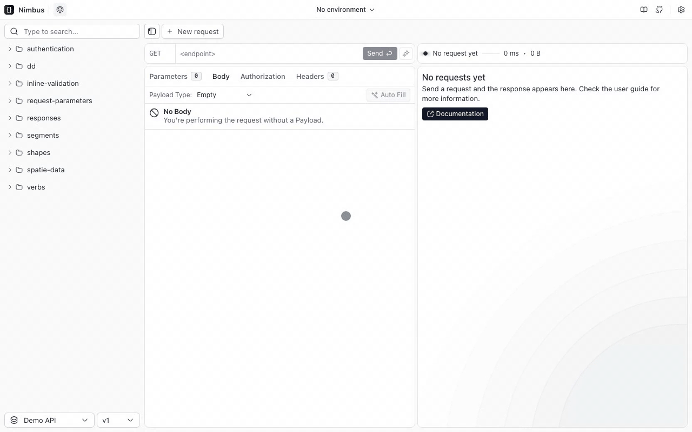

[](https://packagist.org/packages/sunchayn/nimbus)
[](https://packagist.org/packages/sunchayn/nimbus)
[](https://packagist.org/packages/sunchayn/nimbus)
[](https://packagist.org/packages/sunchayn/nimbus)
<a href="https://packagist.org/packages/sunchayn/nimbus"></a>
[](https://codecov.io/github/sunchayn/nimbus)

**An API client that already knows your routes.**

Nimbus is an in-browser API client for Laravel.

It reads your routes, validation rules, and data transfer objects from your source code and builds each request form for you.
You send the request as any user, see the queries, logs, and events next to the response, and roll back the database changes when you are done.



## Why Nimbus?

Traditional HTTP clients, such as Postman and Bruno, run outside your application.

You copy each URL by hand, write each JSON body from scratch, refresh tokens, and clean the database after a destructive test.
When a response looks wrong, you open another tool to find out why.

Nimbus runs inside your local app, so it already knows.

* **Your routes become the request form.** Nimbus parses routes, Form Requests, DTOs, and inline validation rules by static analysis.
* **Send as any user.** Pick a user and a guard, and Nimbus authenticates the request.
* **See what happened.** Queries, N+1 warnings, logs, dispatched events, and `dd()` output appear beside the response.
* **Undo the DB changes.** POST, PUT, and DELETE requests can run inside a transaction that rolls back on every database connection you configure.

## Installation

Nimbus needs PHP 8.2 or higher and Laravel 10, 11, 12, or 13.

**1. Install the package.**

```bash
composer require --dev sunchayn/nimbus
```

**2. Publish the assets and config.**

```bash
php artisan vendor:publish --tag=nimbus-assets --tag=nimbus-config
```

**3. Open Nimbus.**

Start your application and go to `/nimbus`, for example `http://your-app.test/nimbus`.

> [!NOTE]
> **Single-threaded servers**<br/>
> The `php artisan serve` and Laravel Sail handle one request at a time, so relayed requests can time out.<br/>
> See the [single-threaded setup guide](wiki/user-guide/README.md#making-nimbus-work-with-single-threaded-servers) for workarounds.

> [!WARNING]
> **Local development only**<br/>
> Nimbus can run requests as any user in your system.
> Don't enable it on a server that is reachable from the public internet.

## Features

### Build requests from your code
- **Route and schema discovery.** Routes, parameters, and types come from Form Requests, DTOs, and inline rules.
- **OpenAPI support.** When a spec exists, Nimbus merges it with what it finds in your routes.
- **Autofill.** Fill a request body with realistic test data in one click.

### Send as any user
- **Actor impersonation.** Act as any user on any guard, with integer, UUID, or ULID keys, and find the user in a search picker.
- **Request sandbox.** Fake outbound HTTP calls, mail, queued jobs, and notifications for a single request.
- **Time travel.** Run a request as if it were a specific date and time.

### See what happened
- **Request insights.** Database queries, timings, N+1 warnings, logs, and events on the same screen as the response.
- **Debug interception.** `dd()` output opens in a paginated viewer instead of breaking the response.
- **History.** Search past requests and restore the full state of any of them.

### Keep your data safe
- **Transaction rollback.** Destructive requests roll back on every configured database connection.

### Share work with your team and your tools
- **Git-backed workspaces.** Saved requests are plain files in your repository, so you review them in pull requests.
- **Shared Links.** Pre-configure a request and share it with your team-mate with one click.
- **MCP server.** AI coding assistants can list routes, read schemas, and check endpoint behavior inside a rollback.

### Laravel toolbox
A dedicated page for tools that can be helpful dealing with your APIs.
- Decrypt session cookies.
- Create and verify temporary signed URLs.
- Decode JWT and Sanctum tokens.
- Check a password against a hash.

## How Nimbus compares

Nimbus trades breadth for depth.
It does less than a general client, and it does more inside a Laravel app.

| Capability | Nimbus | Postman, Bruno | Swagger, Scribe | Telescope |
| :--- | :---: | :---: | :---: | :---: |
| Finds routes and rules without setup | **Yes** | No | Yes, as static docs | No |
| Interactive request builder | **Yes** | Yes | Playground only | No |
| Act as any user on any guard | **Yes** | Manual tokens | No | No |
| Database rollback on all connections | **Yes** | No | No | No |
| Queries and logs beside the response | **Yes** | No | No | Separate dashboard |
| `dd()` interception | **Yes** | Partial<br /><i>(may render HTML)</i> | No | Dumps only |
| MCP server for AI agents | **Yes** | Yes | No | No |
| Requests stored in Git | **Yes** | Partial | Not applicable | Not applicable |
| External third-party APIs | No | **Yes** | No | Outbound logs only |
| GraphQL, gRPC, WebSockets | No | **Yes** | Partial | No |
| JavaScript test scripts | No | **Yes** | No | No |
| CI collection runner | No | **Yes** | Partial | No |
| Hosted cloud sync and team workspaces | No | **Yes** | Static sites | Self-hosted |
| Public customer documentation | No | No | **Yes** | No |
| Staging and production monitoring | No | Monitors only | No | **Yes** |

Nimbus is not a documentation generator and not a general API client.
You might use Scribe or Scramble for public docs, and Postman or Bruno for APIs you do not own.

## Documentation

* [User guide](wiki/user-guide/README.md) covers the interface and troubleshooting.
* [Contributor guide](wiki/contribution-guide/README.md) covers the architecture, AST extractors, and the local workbench.

## License

Nimbus is open-source software licensed under the [MIT license](LICENSE.md).
