# User Guide

**Nimbus** - An integrated, in-browser API client for Laravel with automatic schema discovery.

This guide covers everything you need to know about using Nimbus to test and explore your Laravel APIs.

---

## Table of Contents

- [Getting Started](#getting-started)
    - [Installation](#installation)
    - [Accessing Nimbus](#accessing-nimbus)
    - [Interface Overview](#interface-overview)
- [Using Nimbus](#using-nimbus)
    - [Route Explorer](#route-explorer)
    - [Request Builder](#request-builder)
        - [Request Options](#request-options)
    - [Response Viewer](#response-viewer)
        - [Cookie Inspection](#cookie-inspection)
        - [Dump and Die Responses](#dump-and-die-responses)
        - [Request History](#request-history)
- [Authentication](#authentication)
    - [Session-Based Authentication](#session-based-authentication)
    - [Bearer Tokens](#bearer-tokens)
    - [Basic Auth](#basic-auth)
    - [User Impersonation](#user-impersonation)
- [Advanced Features](#advanced-features)
    - [Global Headers](#global-headers)
    - [Value Generators](#value-generators)
    - [Environments](#environments)
    - [Auto-Fill Payloads](#auto-fill-payloads)
    - [Transaction Mode](#transaction-mode)
    - [Export to cURL](#export-to-curl)
    - [Export as Code](#export-as-code)
    - [Shareable Links](#shareable-links)
    - [OpenAPI Support](#openapi-support)
    - [Routes Snapshot](#routes-snapshot)
- [Configuration](#configuration)
- [Troubleshooting](#troubleshooting)
    - [Making Nimbus work with single-threaded servers](#making-nimbus-work-with-single-threaded-servers)
    - [Routes Not Appearing](#routes-not-appearing)
    - [Interface Not Loading](#interface-not-loading)
    - [Relay Endpoint Not Working](#relay-endpoint-not-working)
    - [Authentication Issues](#authentication-issues)
    - [Schema Validation Errors](#schema-validation-errors)
- [Getting Help](#getting-help)

---

## Getting Started

### Installation

#### Requirements

- PHP 8.2 or higher.
- Laravel 10.x, 11.x, or 12.x.

#### Install via Composer

```bash
composer require sunchayn/nimbus
```

#### Publish Configuration and Assets

```bash
php artisan vendor:publish --tag=nimbus-assets --tag=nimbus-config
```

This publishes:
- `config/nimbus.php` - Configuration file
- Frontend assets required for the interface

#### Check the Setup

Run the doctor command to find setup problems.

```bash
php artisan nimbus:doctor
```

It checks the config values, the routes snapshot folder, the app key, the authentication guard and its provider, the single threaded server problem, and whether the base URL can be reached.

The same checks run from the **Diagnostics** button on the settings page.

### Accessing Nimbus

Once installed, start your Laravel application using a real web server (Herd, Sail, Docker, Nginx, etc.) and navigate to:

```
http://your-app.test/nimbus
```

**Important**: If you're using Laravel Sail or `php artisan serve`, see [Making Nimbus work with single-threaded servers](#making-nimbus-work-with-single-threaded-servers) for a workaround.

### Interface Overview

The Nimbus interface consists of three main panels:

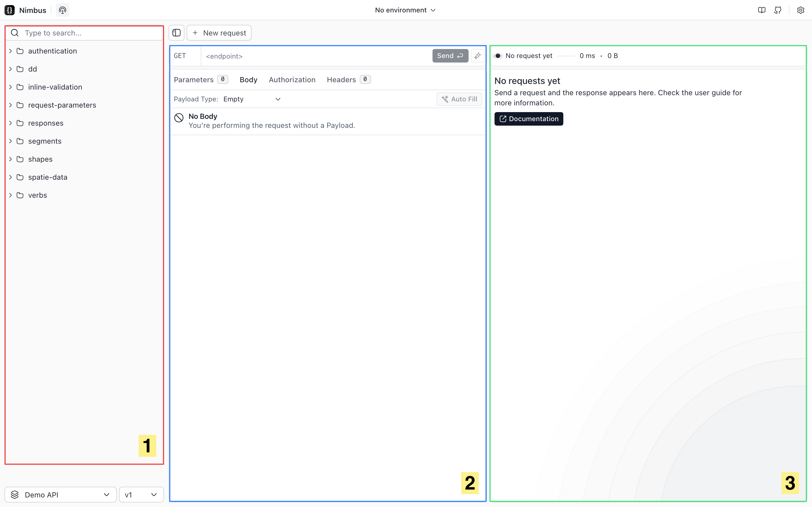

1. **Route Explorer** (left) - Browse and select API routes.
2. **Request Builder** (center) - Configure and send requests.
3. **Response Viewer** (right) - View responses and details.

The top bar gives you access to the **HTTP Client**, the **environment menu** (see [Environments](#environments)), the documentation, the GitHub repository, and the settings page.

Every route you open gets its own request tab above the Request Builder. Use **New request** to start from a blank tab, and the sidebar toggle next to the tabs to hide or show the Route Explorer.

#### Keyboard Shortcuts

Press `?` at any time to see the list of shortcuts.
The command icon in the top bar also opens the command palette and shows its key on hover.

| Mac | Windows and Linux | Action |
|---|---|---|
| `Cmd+K` | `Ctrl+K` | Open the command palette |
| `Cmd+Enter` | `Ctrl+Enter` | Send the request |
| `Cmd+L` | `Ctrl+L` | Focus the endpoint |
| `Cmd+B` | `Ctrl+B` | Show or hide the routes |
| `Option+1` to `Option+9` | `Alt+1` to `Alt+9` | Switch to a tab by position |
| `?` | `?` | Show the shortcuts |

Some browsers keep `Cmd+L` or `Ctrl+L` for themselves.
Use the command palette in that case.

The command palette searches routes, open tabs, and environments, and runs actions.
The actions are new tab, close tab, switch environment, switch application, toggle transaction mode, toggle theme, open settings, clear history, and copy as code.

---

## Using Nimbus

### Route Explorer

The Route Explorer automatically discovers your Laravel API routes and organizes them by resource.

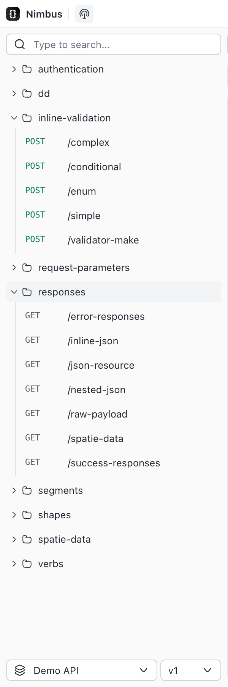

**Features:**
- **Search**: Quickly filter routes by endpoint path.
- **Application Switcher**: Switch between multiple API applications (e.g., Rest API, CMS API) if configured. It sits at the bottom of the sidebar.
- **Version Selector**: If the active application is versioned, a version picker appears next to the application switcher.
- **Resource Groups**: Routes are automatically grouped by resource (e.g., `users`, `products`).
- **Nested Folders**: Optionally, routes are grouped in nested folders that follow the URI. See [Nested Folders](#nested-folders).
- **HTTP Methods**: Each route explicitly shows its supported methods.
- **Quick Load**: Click any route to immediately load it into the Request Builder. Each route opens in its own request tab.
- **Authentication Badge**: A lock icon marks routes that use the `auth` middleware. A new tab for such a route starts with the last authorization you used, when the current one is **None**.
- **Throttle Hint**: A route with `throttle` middleware shows a timer icon in the routes list. Hover over it to read the limit, for example "60 requests per minute".
- **Parameter Hints**: When route parameters are missing, the warning lists the model bound to each parameter and its `where` pattern.

Nimbus reads this from the route middleware, resolved through the router. Only known authentication middleware such as `auth`, `auth:sanctum`, and `auth.basic` marks a route as protected. Custom middleware is never guessed.

#### Nested Folders

By default, each resource is one folder named after the first URI segment.
Set `nested_folders` to `true` in `config/nimbus.php` to follow the full URI instead.
The URI segments before the action become nested folders.

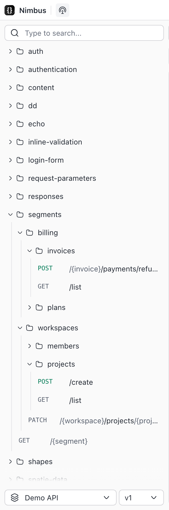

For example, `POST /billing/invoices/{invoice}/payments/refund` is listed in `billing` > `invoices`.

- The last URI segment is the action, so it never becomes a folder.
- A route parameter such as `{invoice}` ends the folder path. The segments after it stay in the route label.
- The setting applies to all applications.

### Request Builder

The Request Builder provides an intuitive interface for configuring API requests.

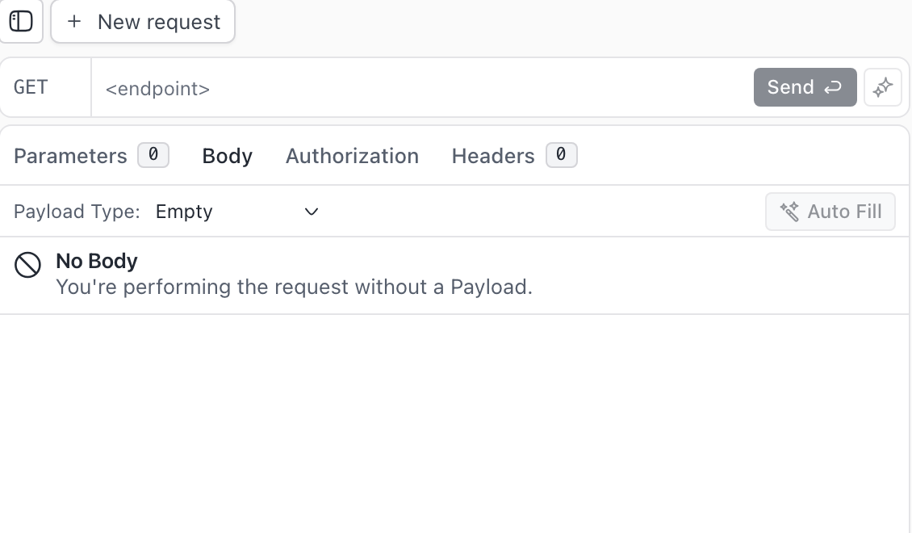

#### Components

**Method Selection**
- HTTP method is automatically set from the route.
- The methods supported by the route are groupped together in the list.

**URL Parameters**
- Add query string parameters.
- The tab shows a counter with the number of parameters.
- Real-time URL preview.

**Headers**
- Add custom headers.
- Global headers automatically included.
- The tab shows a counter with the number of headers.

**Request Body**
- JSON editor with syntax highlighting.
- Schema validation based on Laravel validation rules.
- Real-time validation feedback.
- Form Data editor with text and file rows. See [Uploading Files](#uploading-files).
- Form URL Encoded editor with text rows, sent as `application/x-www-form-urlencoded`.
- HTML and XML body types that send the text with `text/html` or `application/xml` as the `Content-Type` header, unless you set one yourself.
- Binary body that sends one file as the raw request body. The `Content-Type` header comes from the file type unless you set one yourself.
- Auto Fill works for Form URL Encoded the same way it works for Form Data. After a page reload, pick a binary file again.

**Authorization**
- Multiple authentication methods.
- See [Authentication](#authentication) section for details.

#### Schema-Aware Editing

Nimbus analyzes your Laravel validation rules to provide intelligent editing:

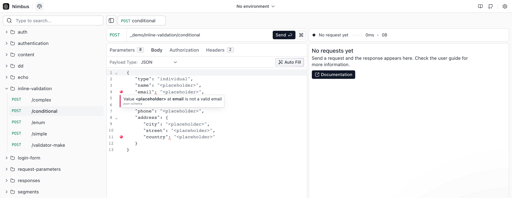

**Validation Features:**
- Required fields are highlighted.
- Field types are enforced (string, number, boolean, etc.).
- Validation errors shown in real-time.
- Nested object and array support.

Rules that Nimbus does not know never break the extraction. They are ignored.

#### Uploading Files

Send files from the **Form Data** body type. Each row is either text or a file.

**How to use:**
1. Open the **Body** tab and select **Form Data** as the payload type.
2. Click **Add** to create a row.
3. Change the row type from **Text** to **File**.
4. Enter the field name and click **Choose file** to pick a file from your computer.
5. Send the request. Nimbus sends the body as `multipart/form-data` with a boundary, so your app receives a regular upload.

**Sending several files:**
Each row holds one file. To send several files, add one row per file and use an array name such as `photos[]` or `photos[0]`. Rows that share the `photos[]` name are all kept and arrive in your app as a list.

**Things to know:**
- The browser keeps the file only for the current page. After a refresh, the row shows `name (select the file again)` and the file is not sent until you pick it again.
- History and shareable links keep the file name only, never the file contents.
- File rows are only available in Form Data bodies. GET and HEAD requests send body fields as query parameters, so files are dropped.
- The limits of your app apply, such as `upload_max_filesize` and `post_max_size` in `php.ini`, and any `max` rule on the field.

#### Auto-Fill Payloads

Populate entire request payloads with realistic test data.

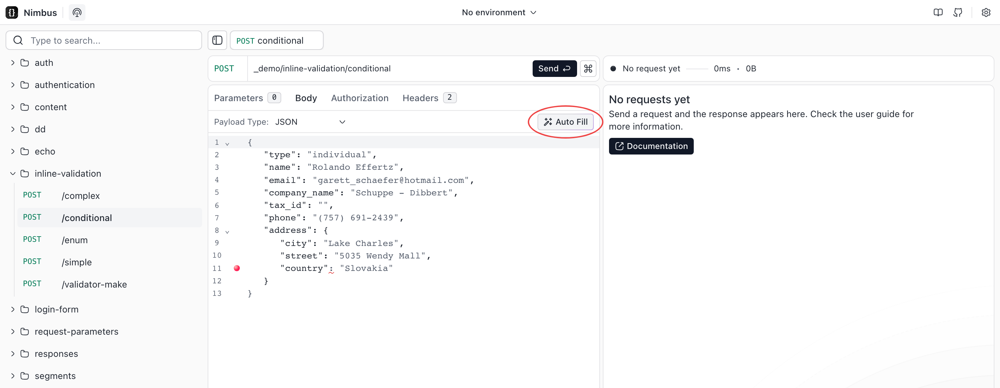

**How it works:**
1. Click the "Auto Fill" button.
2. Nimbus generates values based on validation rules and field names.
3. Review and modify generated values as needed.

**Smart Generation:**
Field names are cross-checked against a pre-defined set of patterns, common names will get an adequate generated value that cannot normally be inferred from a validation rule (e.g., the address fields from the example above):
- `email` fields → realistic email addresses
- `password` fields → secure random passwords
- `uuid` fields → valid UUIDs
- `date` fields → properly formatted dates
- Numeric fields → values within min/max constraints
- Fields with a `regex`, `digits`, `alpha` or `alpha_dash` rule → text that matches the pattern
- Fields with an `ip`, `ipv4` or `ipv6` rule → a valid IP address

Optional fields that cannot be empty are left out of the payload sometimes, instead of being sent empty.

#### Request Options

The **Request Options** menu in the endpoint bar holds settings that apply to the current request.

- **Follow redirects**: On by default. Turn it off to see the redirect response itself.
- **Verify SSL**: Starts On for production targets and Off for other targets, so self-signed certificates work. Turn it On or Off to override this for the request.
- **Timeout (seconds)**: 30 by default. Accepts 1 to 300.

### Response Viewer

The Response Viewer displays detailed information about API responses.

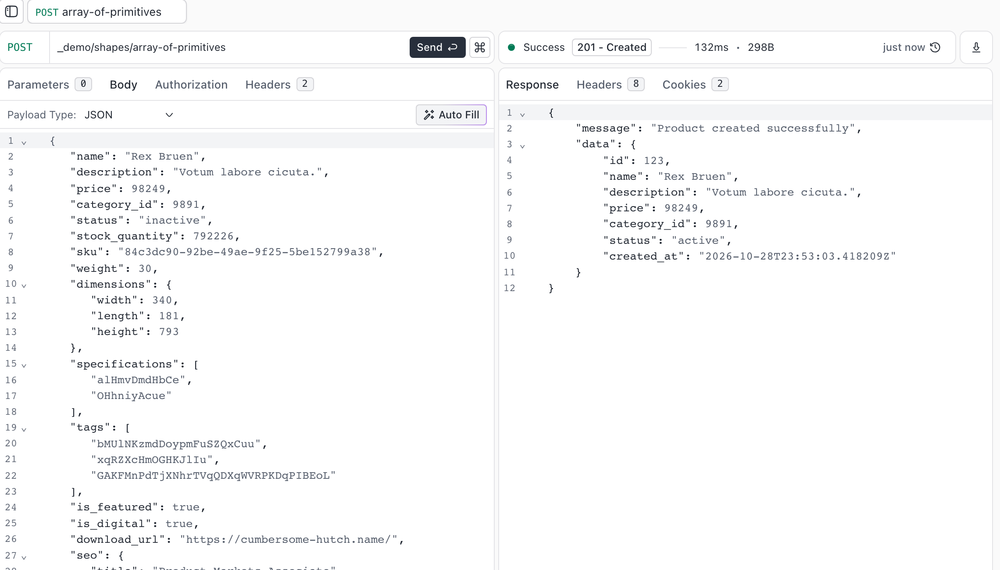

**Displayed Information:**
- HTTP status code with description.
- Response time in milliseconds.
- Complete response headers.
- Formatted response body with syntax highlighting.
- Cookie information (see [Cookie Inspection](#cookie-inspection)).

The Response, Headers, and Cookies tabs show a counter when they have items.

The **Plain** tab shows the raw request as the target received it, then the raw response.
The request shows the final URL, the headers, and the body after variables are resolved.
Nothing is masked, so authorization headers are visible.

**Features:**
- Collapsible sections for better organization.
- Copy response body to clipboard.
- Download raw response bodies as files with appropriate extensions based on Content-Type, using the download button at the end of the status bar.
- Download the response type shape resolved via static analysis of controllers and resources.
- Pretty-printed JSON for readability.

#### Response Tools

The response body has these tools.

- **Search**: Press `Cmd+F` on macOS or `Ctrl+F` on Windows and Linux while the pointer is over the response body, or while it has focus. A search box opens in the top right corner of the body and highlights the matches. The counter shows the current match and the total. Use the arrows or Enter to move between matches. The current match is centered in the viewer. Press `Esc` to close it.
- **Pretty and Raw tabs**: A JSON body has two tabs. **Pretty** shows the formatted body and **Raw** shows it as one compact line.

#### Cookie Inspection

View and decrypt Laravel session cookies with ease.

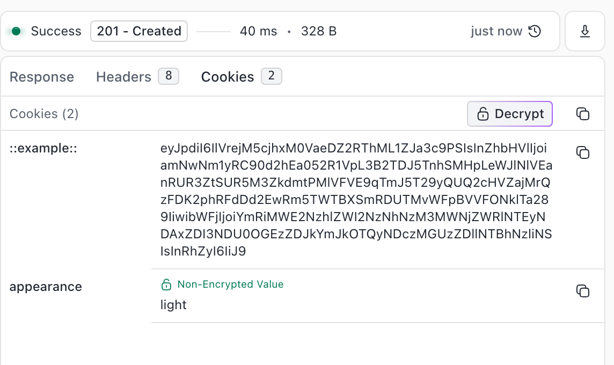

**Raw Cookies:**
The raw values as observed in the `Set-Cookie` headers from the response.

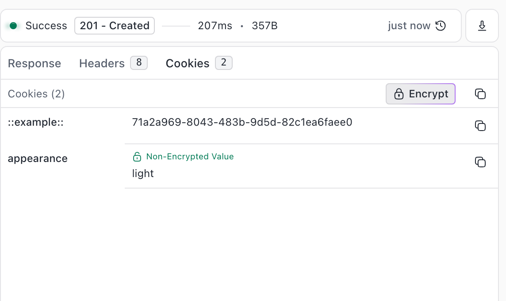

**Decrypted Cookies:**
Automatic decryption of Laravel encrypted cookies.

#### Dump and Die Responses

When a `dd()` response is detected. Nimbus will switch to a rich `dd` response viewer where you can navigate the dump(s) as a JSON object.

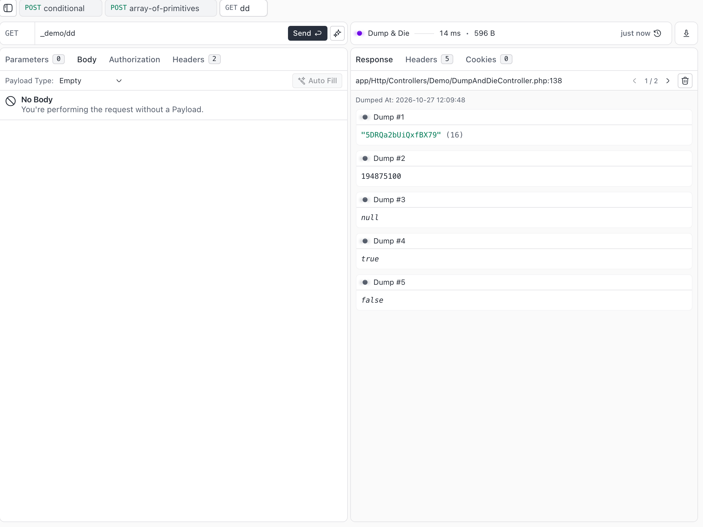

You can also see the file name and line shown under the tabs (e.g. `app/Http/Controllers/Demo/DumpAndDieController.php:140
`) which is the source that made these dumps.

_Note: dumps are only sticky for connectives `dd` responses, having a non-`dd` response will earse the history._

##### Dumps withing the same debug window

When keep sending `dd` responses, the previous values can still be accessed via pagination. You can always delete the unwanted ones.

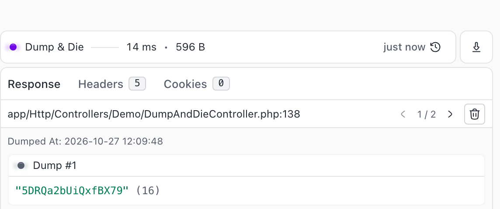

#### Request History

Nimbus keeps a log of every request you send, allowing you to quickly "rewind" to a previous state.

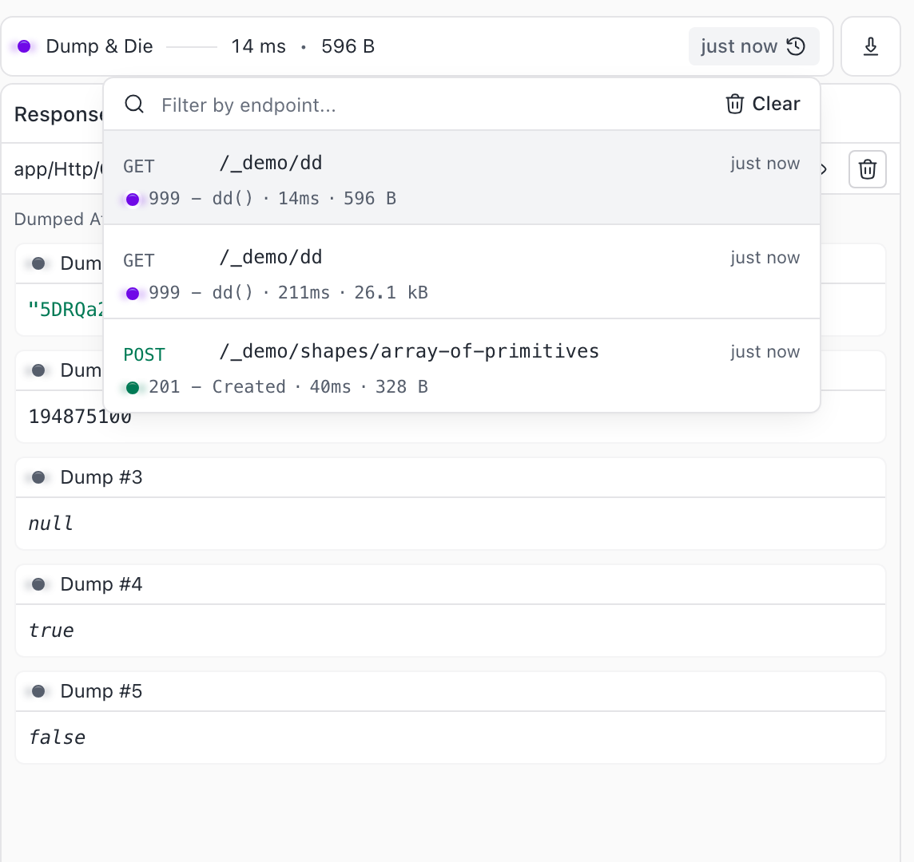

**Features:**
- **Automatic Logging**: Every execution is recorded with its timestamp, request details, and response status.
- **Searchable Logs**: Use the filter input within the history dropdown to filter by endpoint path.
- **Full Restoration**: Clicking any history item will restore the **entire Request Builder state**, including:
    - HTTP Method and Endpoint
    - Headers and Query Parameters
    - Request Body & Payload Type
    - Authentication settings
- **Persistent Session**: Your history is preserved across page refreshes.

**How to use:**
1. Click on the relative timestamp (e.g., "5m ago") in the response status bar.
2. Browse or filter your previous requests by endpoint.
3. Click a log entry to restore its state into the Request Builder.
4. Use the "Clear" button to purge your session logs.

**Limits and storage:**
- Set **Maximum history logs** (10 to 1000) in **Settings**, under **Request History**.
- Nimbus keeps history in the browser storage, which is small. When the history gets too large, the oldest logs are dropped.
- Stored response bodies are cut at 256 KB. A cut body shows a **Stored body truncated** notice. Send the request again to see the full body.
- When the browser storage is full, Nimbus removes responses from inactive tabs first, then the oldest history, and shows a warning.

#### Downloading Responses

Use the download button at the end of the response status bar to open the download options. **Raw response** downloads the response body (as is) as a file. The extension will be inherited from the `Content-Type` header.

**JSON shape** downloads the response type shape* resolved via static analysis of controllers and resources.

_*This feature is only available for `application/json` responses._

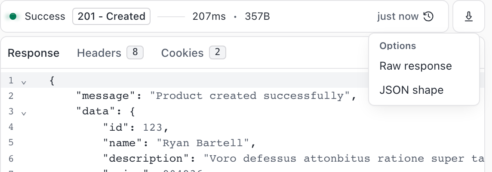
---

## Authentication

Nimbus supports multiple authentication methods for testing protected endpoints. Pick one from the **Authorization Type** menu in the Authorization tab.

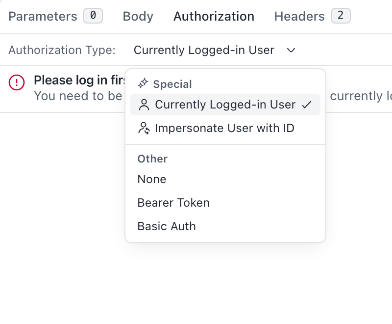

### Session-Based Authentication

**Currently Logged-in User** allows you to make requests as the currently logged-in user from your main application.

**How it works:**
1. Log into your Laravel application in another tab.
2. Select "Currently Logged-in User" in Nimbus.
3. Requests will include your session cookies.

### Bearer Tokens

Standard Bearer token authentication for API endpoints.

**Use case:** Testing JWT or Sanctum token-protected endpoints.

**How to use:**
1. Select "Bearer Token" from authentication options.
2. Enter your access token.
3. Token is sent in `Authorization: Bearer {token}` header.

### Basic Auth

HTTP Basic Authentication with username and password.

**Use case:** Testing endpoints protected with Basic Auth.

**How to use:**
1. Select "Basic Auth" from authentication options.
2. Enter username and password.
3. Credentials are base64-encoded and sent in `Authorization` header.

### User Impersonation

Make requests as any user in your system using their user ID.

**Use case:** Testing how endpoints behave for different users without logging in as them.

**How it works:**
1. Select "Impersonate User with ID" from authentication options.
2. Enter the user ID.
3. Nimbus authenticates the request as that user.

---

## Advanced Features

### Global Headers

Configure headers that are automatically included in every request.

**Configuration:**

Edit `config/nimbus.php`:

```php
'headers' => [
    'x-api-version' => '1.0',
    'x-request-id' => \Sunchayn\Nimbus\Modules\Config\GlobalHeaderGeneratorTypeEnum::Uuid,
    'x-session-id' => \Sunchayn\Nimbus\Modules\Config\GlobalHeaderGeneratorTypeEnum::Uuid,
    'host' => 'example.com',
],
```

**Dynamic Values:**

Use `GlobalHeaderGeneratorTypeEnum` for randomly generated values, for example:
- `Uuid` - Generate a UUID for each request
- Additional generators available in the enum

**Use cases:**
- API versioning headers.
- Request tracking IDs.
- Custom authentication keys.
- Host headers for multi-tenant apps.

### Value Generators

Generate realistic values for headers and parameters on-demand.

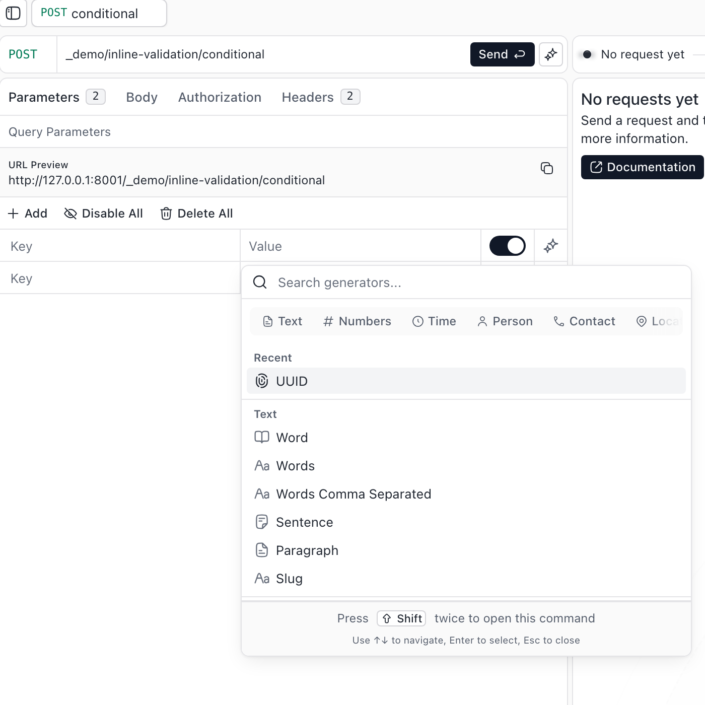

**How to use:**
1. Focus on a value input field.
2. Click the generator icon (or press Shift twice).
3. Search or filter by category, then select the type of value to generate.
4. Press Enter or click on the generator to insert.

**Available generators:**
- UUIDs.
- Email addresses.
- Names (first, last, full).
- Dates (various formats).
- Phone numbers.
- URLs.
- And more...

### Environments

An environment is a target that requests are sent to, such as the current host, staging, or production. Each environment has a name, a base URL, and its own list of variables. Use them to switch between servers, API keys, tokens, or any other dynamic configuration without editing each request.

There are three kinds of environments:

- **Current host**: The default environment, shown as **Local** when Nimbus runs locally. It is the host Nimbus runs on, so it can be local, staging, or production. It always exists, uses the base URL of the application (see `base_url` in the [configuration](#configuration)), and cannot be disabled or deleted. It is the only environment that supports all Nimbus features.
- **Pre-configured**: Environments defined in `config/nimbus.php` under `environments`, such as Staging and Production. They are disabled until you enable them. Their name and base URL are read only in the UI.
- **Custom**: Environments you add from the Environments page. You can rename them, change their base URL, and delete them.

Non-custom environments are shared by all applications. The active application keeps its own route prefix, so only the host changes when you switch environments.

#### Host Detection

Nimbus can run on any host, so the Current host entry is not always a local machine. Nimbus compares the host with the configured environments. It checks `app.url` first and uses `app.env` as a fallback.

When a configured environment matches, it is merged into the Current host entry and removed from the list. The entry is then named after it, for example **Production (current host)**.

When nothing matches and the host is local (`app.env` is `local` or `app.url` points to localhost), the entry is named **Local**. Otherwise, it is named **Current host**.

#### Managing Environments

Open the environment menu in the top bar and select **Manage environments**.

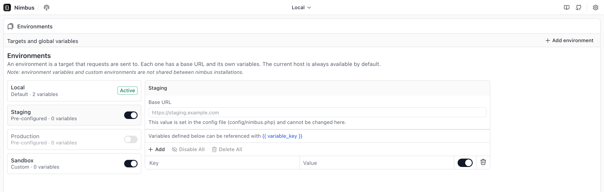

1. **Environment List**: Every environment is listed, including disabled ones. Use the toggle to enable or disable a pre-configured or custom environment. The active environment is marked with an **Active** badge.
2. **Base URL**: Shown for the selected environment. It is editable only for custom environments. For the others, it comes from the config file.
3. **Variable Editor**: Each variable consists of a key, a value, and an enabled toggle. Pre-configured environments and the Current host can have variables too.
4. **Add environment**: Creates a custom environment. The base URL must be an absolute `http` or `https` URL.

Custom environments, variables, and the enabled state are saved in your browser. They are not shared between Nimbus installations.

#### Switching Environments

Select an environment from the menu in the top bar. Only enabled environments are listed.

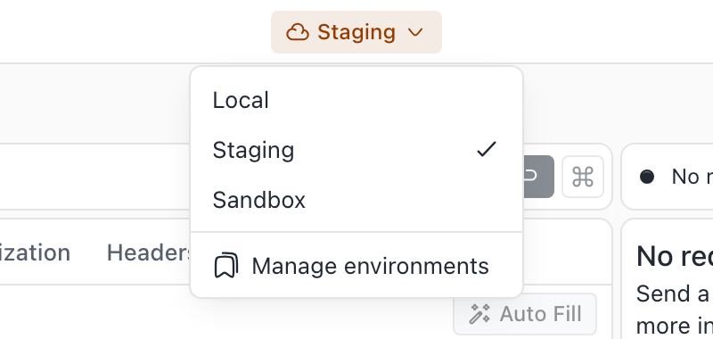

When the active environment is not the current host, the menu button shows a cloud icon and a warning color, and Production is shown in red. The current host uses a neutral color, unless it was detected as Production (red) or Staging (warning color). Requests are sent to the base URL of the active environment. The URL preview and the exported cURL command use it too. Open tabs keep their path and use the new base URL when you send them.

#### Current Host Only Features

Some features depend on the application Nimbus runs on, so they are not available on other environments:

- Impersonate user and logged in user authorization. Tabs that use them fall back to **No auth** when you switch away from the current host.
- Cookie decryption. Cookies are shown raw and the **Decrypt** button is disabled.
- The special authentication injector. No host session or remember me cookie is sent to a base URL other than the current host.

Bearer, basic auth, and manual headers work on every environment.

#### Configuring Environments

Add pre-configured environments under the global `environments` key in `config/nimbus.php`:

```php
'environments' => [
    'staging' => [
        'name' => 'Staging',
        'base_url' => 'https://staging.example.com',
        'enabled' => false,
    ],
],
```

Do not list the local environment, the current host is always added for you. If Nimbus runs on one of the listed environments, Nimbus detects it as described in [Host Detection](#host-detection).

The key is the environment id. `base_url` is required and must be an absolute `http` or `https` URL. A `current` key is ignored. This option is unrelated to `allowed_envs`, which controls where Nimbus itself is accessible.

#### Using Variables

To reference an environment variable, use the double-brace syntax: `{{ variable_name }}`. Nimbus provides real-time resolution as you type.


#### Dynamic Variables

Dynamic variables use single braces and a `$` prefix, such as `{$uuid}`. They create a new value each time you send a request.
They have their own syntax and are not related to the environment variables, which keep the `{{ name }}` syntax.
A dynamic variable used several times in one request has the same value everywhere in that request.

| Variable | Value |
|----------|-------|
| `{$uuid}` | A random UUID. |
| `{$timestamp}` | A Unix timestamp. |
| `{$isoDate}` | An ISO 8601 date and time. |
| `{$randomInt}` | A random integer. |
| `{$email}` | A random email address. |

They work in the same places as environment variables.
In a JSON body, a dynamic variable is a valid value even without quotes, for example `{ "id": {$uuid} }`. The editor does not report it as an error.

Type `{{` in an input or an editor to suggest environment variables, and type `{$` to suggest dynamic variables.
Dynamic entries show a sample value.

#### Supported Inputs

Environment variables are supported in nearly all input fields where dynamic values are useful:

| Location | Supported Inputs |
|----------|------------------|
| **Request URL** | The main endpoint bar, including host, path, and query segments. |
| **Authentication** | Username and password for Basic Auth, and Bearer tokens. |
| **Headers** | Header values (but not keys). |
| **Query Parameters** | Parameter values (but not keys). |
| **Request Body** | The entire content of JSON and Plain Text editors. |

#### Visual Indicators and Feedback

Nimbus provides immediate visual feedback on the status of your environment variables:

- **Grey**: The variable exists in the active environment and is successfully resolved.
- **Orange**: The variable is found, but its value is currently empty.
- **Red**: The variable cannot be found in the currently selected environment.

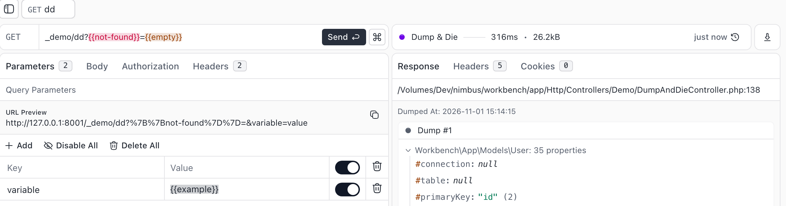

### Transaction Mode

Transaction Mode allows you to execute requests without affecting your database. This is particularly useful for testing destructive operations (like creating, updating, or deleting records) without having to manually clean up your test data.

**How it works:**
1. Click the **Request Options** (sparkles) icon in the endpoint bar.
2. Toggle **Transaction mode** to **ON**.
3. Execute your request.
4. Nimbus wraps the entire request in a database transaction and automatically rolls it back once the request is complete.

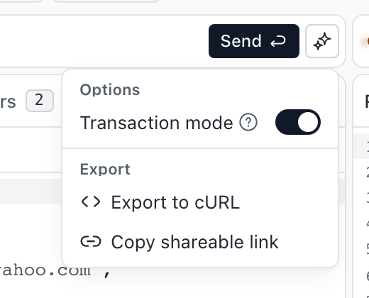

**Note:** Only database operations are rolled back. External side effects like sending emails, making external API calls, or file system changes will still occur.

### Export to cURL

Export configured requests as cURL commands for use in terminals or scripts.

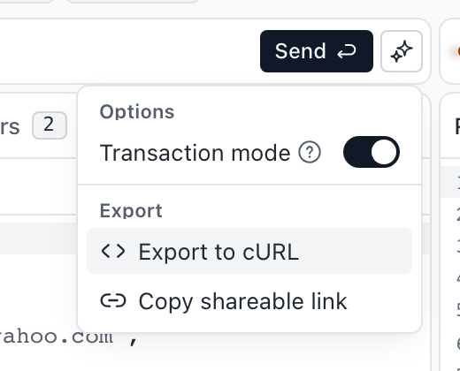

**How to export:**
1. Configure your request completely.
2. Click the **Request Options** (sparkles) icon in the endpoint bar.
3. Select **Export to cURL**.
4. Copy the generated cURL command.

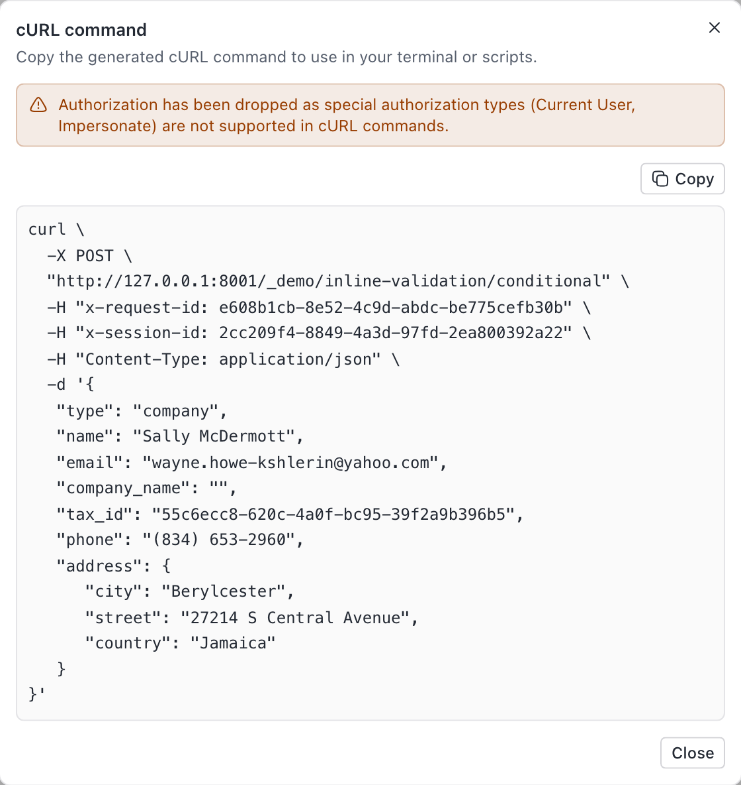

**What's included:**
- Full URL with parameters
- All headers (including global headers)
- Authentication credentials
- Request body. Form Data uses `-F`, Form URL Encoded uses `--data-urlencode`, Binary uses `--data-binary` with the file name, and the other types use `-d`.
- HTTP method

### Export as Code

Export configured requests as code samples. This is separate from the cURL export.

**How to export:**
1. Configure your request completely.
2. Click the **Request Options** (sparkles) icon in the endpoint bar.
3. Select **Export as code**.
4. Pick a language in the list, then copy the code. Long lines scroll horizontally in the code box.

**Languages:**
- JavaScript with `fetch`
- JavaScript with Axios
- PHP with the Laravel `Http` facade
- PHP with Guzzle
- A Pest feature test
- A PHPUnit feature test

Environment variables and dynamic variables are resolved in the code. Secrets are replaced with placeholders such as `YOUR_TOKEN`. This covers Bearer and Basic authorization, and any header, query parameter or JSON field whose name contains `token`, `secret`, `password`, `api key`, `authorization`, `cookie` or `csrf`.

The tests assert the status code of the last response, or 200 when there is none.

### Shareable Links

Shareable links allow you to capture the exact state of your Request Builder and share it with others. This is perfect for bug reports, API demonstrations, or collaborating on complex request configurations.

**Capture everything:**
- HTTP Method and Endpoint
- Headers and Query Parameters
- Request Body & Payload Type
- Authentication settings
- Last response metadata (status, duration, and size)

**How to use:**
1. Configure your request (and optionally execute it to include response context).
2. Click the **Request Options** (sparkles) icon in the endpoint bar.
3. Select **Copy shareable link**.
4. Share the generated URL.

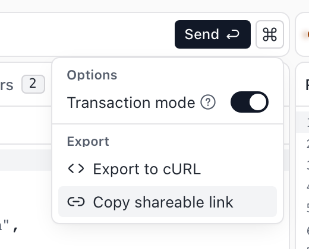

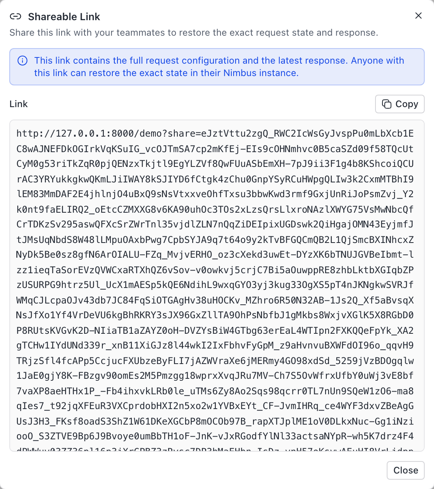

**Automatic Restoration:**
When a shareable link is opened, Nimbus will:
- Parse and decompress the payload.
- Automatically restore all request data.
- **Switch Applications**: If the link points to a route in a different application (e.g., from `Rest API` to `Admin API`), Nimbus will automatically switch the active application context for you.

### OpenAPI Support

By default, Nimbus auto-detects routes from your Laravel application. However, you can also configure Nimbus to load routes directly from OpenAPI specification files.

**Prerequisites:**

This feature requires the `devizzent/cebe-php-openapi` package:

```bash
composer require devizzent/cebe-php-openapi
```

**Configuration:**

To enable OpenAPI support, update your `config/nimbus.php`:

1.  Set the strategy to OpenAPI:
    ```php
    'strategy' => \Sunchayn\Nimbus\Modules\Config\Enums\RoutesProcessingStrategyEnum::OpenAPI,
    ```

2.  Configure the `openapi` section:
    ```php
    'openapi' => [
        'files' => [
            // For unversioned APIs
            'default' => base_path('docs/openapi.yaml'),

            // OR for versioned APIs (keys must match version segments)
            'v1' => base_path('docs/v1/openapi.yaml'),
            'v2' => base_path('docs/v2/openapi.json'),
        ],

        // Toggle display of Operation IDs in the sidebar instead of the route path
        'show_operation_id' => false,
    ],
    ```

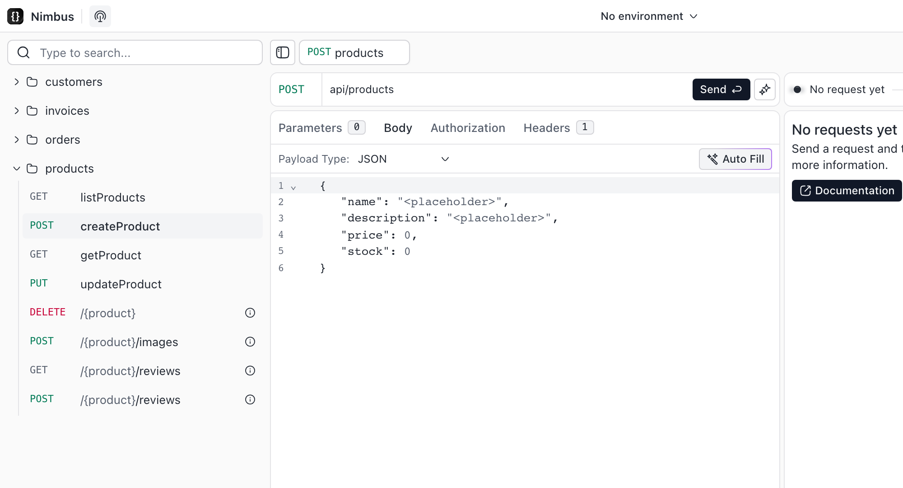

---

### Routes Snapshot

Nimbus reads your controllers, form requests and resources to build the routes you see.
On a large application this takes a noticeable time on every page load.
The routes snapshot saves the result to disk and reuses it while nothing it was built from has changed.

The snapshot is off by default. Turn it on in `config/nimbus.php`:

```php
'snapshot' => true,
```

When it is on, the first load extracts the routes and saves them.
The next loads read the saved file and skip extraction.
Nimbus extracts again by itself when any of these change:

- A route definition, such as its URI, methods, name, action or middleware.
- A source file that the last extraction read, such as a form request, resource or data object.
- The Nimbus configuration of the active application.
- `composer.lock`.
- An OpenAPI specification file, when you use the OpenAPI strategy.

Nimbus compares the size and modification time of each file and never reads its content. Touching a file triggers one extra extraction.

**Refresh routes:**

When the snapshot is on, a refresh button appears next to the search field.
Hover it to see when the routes were last updated.
Click it to extract again and replace the snapshot.

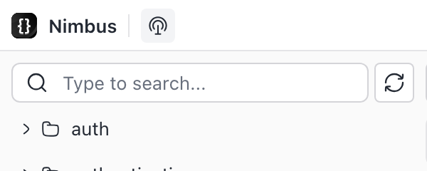

You can also open `/nimbus/?refresh` to force extraction on page load.

**Clear snapshots:**

Run this command to delete the snapshots of all applications, for example in a deploy script:

```bash
php artisan nimbus:snapshot:clear
```

Adding a route to the ignored routes list also clears the snapshots.

**What it does not detect:**

- A class that did not exist when the snapshot was made, such as a form request you created later. The route definition usually changes with it. Use the refresh button if it does not.
- Database changes, including migrations. Use the refresh button.

**Where snapshots are stored:**

Snapshots live in `vendor/sunchayn/nimbus/storage`, one file per application.
They contain schema data only and are not served over HTTP.
If the folder is not writable, Nimbus still works and extracts on every load.

## Configuration

The `config/nimbus.php` file provides customization options:

```php
return [

    'prefix' => 'nimbus',

    'allowed_envs' => ['local', 'staging'],

    'nested_folders' => false,

    'base_url' => null,

    'environments' => [
        'staging' => [
            'name' => 'Staging',
            'base_url' => 'https://staging.example.com',
            'enabled' => false,
        ],
    ],

    'snapshot' => false,

    'default_application' => 'main',

    'applications' => [
        'main' => [
            'name' => 'Main',

            'routes' => [
                'strategy' => 'auto_detect',

                'openapi' => [
                    'files' => [],
                    'show_operation_id' => false,
                ],

                'prefix' => 'api',
                'versioned' => false,
            ],

            'auth' => [
                'guard' => 'web',
                'special' => [
                    'injector' => 'remember_me_cookie',
                ],
            ],

            'headers' => [
                'X-Request-ID' => '$uuid',
            ],
        ],
    ],
];
```

### Configuration Options

| Option | Description                                                                                                                                                                                           | Default | Example |
|---|-------------------------------------------------------------------------------------------------------------------------------------------------------------------------------------------------------|---|---|
| **`prefix`** | The URI segment under which Nimbus is accessible.                                                                                                                                                     | `'nimbus'` | `'api-client'` |
| **`allowed_envs`** | Environments where Nimbus is enabled. Avoid production for security reasons.                                                                                                                          | `['local', 'staging']` | `['testing', 'local']` |
| **`default_application`** | The base default application to load when no other application is specified.                                                                                                                          | `'main'` | `'rest-api'` |
| **`nested_folders`** | Groups routes in nested folders that follow the URI, instead of one folder per resource. Applies to all applications.<br /><br />See [Nested Folders](#nested-folders). | `false` | `true` |
| **`base_url`** | The base URL of the current host, used when Nimbus relays API requests from the UI. Useful when the API runs on a different domain or port. Applies to all applications. If set to null, Nimbus defaults to the host and scheme of the incoming request. | `null` | `'http://127.0.0.1:8001'` |
| **`environments`** | Pre-configured environments that requests can be sent to. Each key is the environment id and each entry needs a `name`, an absolute `base_url`, and an `enabled` flag. The current host always exists and cannot be listed. See [Environments](#environments). | `[]` | `['staging' => ['name' => 'Staging', 'base_url' => 'https://staging.example.com', 'enabled' => false]]` |
| **`snapshot`** | Saves the extracted routes and reuses them while their source files are unchanged. Applies to all applications.<br /><br />See [Routes Snapshot](#routes-snapshot). | `false` | `true` |
| **`applications.*.routes.prefix`** | The base path used to detect application routes. Only routes starting with this prefix are analyzed.                                                                                                  | `'api'` | `'api/v1'` |
| **`applications.*.routes.versioned`** | Enables version parsing for routes like `/api/v1/...`.                                                                                                                                                | `false` | `true` |
| **`applications.*.routes.strategy`** | The strategy used to discover routes.<br /><br />Supported values: `'auto_detect'` or `'openapi'`.                                                                                                    | `'auto_detect'` | `'openapi'` |
| **`applications.*.routes.openapi.files`** | Map of versions to OpenAPI file paths.<br /><br />Required when strategy is `'openapi'`.                                                                                                                         | `[]` | `['v1' => base_path('docs/v1.yaml')]` |
| **`applications.*.routes.openapi.show_operation_id`** | Defines whether to show the Operation ID in the sidebar.                                                                                                                                              | `false` | `true` |
| **`applications.*.auth.guard`** | The Laravel guard used for API request authentication.                                                                                                                                                | `'web'` | `'api'` |
| **`applications.*.auth.special.injector`** | Injector alias or FQCN string used to attach authentication credentials. <br /><br />Supported values: `'remember_me_cookie'`, `'tymon_jwt'`, or a custom FQCN string.                            | `'remember_me_cookie'` | `'tymon_jwt'` |
| **`headers`** | Global headers applied to all outgoing requests.<br /><br />Supports static values or generator aliases (`'$uuid'`, `'$email'`, `'$string'`).                                                                    | `[]` | `['x-request-id' => '$uuid']` |

### Multi-Application Support

Nimbus allows you to define multiple distinct applications in your configuration. This is ideal for projects with multiple APIs like a REST API and CMS API, or different microservices within the same monolith.

```php
'applications' => [
    'main' => [
        'name' => 'Public API',
        'routes' => [
            'prefix' => 'api/v1',
            'versioned' => false,
        ],
    ],
    'admin' => [
        'name' => 'Admin API',
        'routes' => [
            'prefix' => 'api/admin',
            'versioned' => true,
        ],
    ],
],
```

When multiple applications are defined, an application switcher appears at the bottom of the sidebar, allowing you to quickly toggle between them.

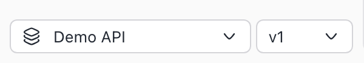

#### Special Authentication Modes

Nimbus comes with built-in authentication injection strategies:

| Mode | Injector Alias | Description |
|---|---|---|
| **RememberMe Cookie** | `'remember_me_cookie'` | Authenticates using Laravel's remember-me cookie for the current session. |
| **JWT Token** | `'tymon_jwt'` | Injects a bearer token for JWT-authenticated APIs. |

Custom injectors can be implemented by providing a FQCN string implementing:

```php
Sunchayn\Nimbus\Modules\Relay\Services\Authorization\Contracts\SpecialAuthenticationInjectorContract
```

#### Versioned Routes

If your routes are versioned (e.g. `/api/v1/users`), set `routes.versioned` to `true`.  
Nimbus will automatically extract and display version segments when generating schema representations.

## Troubleshooting

### Making Nimbus work with single-threaded servers

**Problem:** Nimbus will not work out of the box if you are using Laravel Sail, `php artisan serve`, or directly booting up a PHP built-in server.

**Why this happens:**

These server options are single-threaded, meaning they can only handle one request at a time. When Nimbus relays a request from the UI to your API:

1. The relay endpoint receives the initial request from the browser
2. The relay endpoint tries to make an HTTP request to your API
3. The API request never completes because the same PHP process is busy serving the relay request
4. The request hangs until it times out

When the relay request times out and the target has the same host and port as the page, Nimbus shows an error with the value to set for `base_url` and a link to this section.

**Workaround:**

You can work around this limitation by running two separate server instances on different ports. This allows one instance to handle the Nimbus relay endpoint while the other processes the actual API requests.

**Step-by-step solution:**

1. **Start the first server instance** (for Nimbus UI and relay endpoint):
   ```bash
   php artisan serve --port=8000
   ```
   Or with Sail:
   ```bash
   ./vendor/bin/sail up
   ```

2. **Start a second server instance** (for API requests):
   ```bash
   php artisan serve --port=8001
   ```
   Or with Sail (in a new terminal):
   ```bash
   ./vendor/bin/sail artisan serve --port=8001
   ```

3. **Configure the relay endpoint** to use the second server:

   Edit `config/nimbus.php` and set the global `base_url`:

   ```php
   'base_url' => 'http://127.0.0.1:8001',
   ```

4. **Access Nimbus** at `http://127.0.0.1:8000/nimbus`

Now when you send requests through Nimbus:
- The relay endpoint runs on port 8000
- API requests are forwarded to port 8001
- Both requests can be processed concurrently


### Routes Not Appearing

**Problem:** Your API routes don't show up in the Route Explorer.

**Solutions:**

1. **Check route prefix configuration**
    - Verify `routes.prefix` in `config/nimbus.php` matches your API routes.
    - Default is `api`, so routes should start with `/api/`.

2. **Clear route cache**
   ```bash
   php artisan route:clear
   ```

3. **Verify route registration**
    - Ensure routes are in `routes/api.php`.
    - Check `RouteServiceProvider` (Laravel 10-11) or `bootstrap/app.php` (Laravel 12+).

4. **Refresh the routes snapshot**
    - If `snapshot` is `true`, click the refresh button next to the search field.
    - Or run `php artisan nimbus:snapshot:clear`.
    - See [Routes Snapshot](#routes-snapshot).

### Interface Not Loading

**Problem:** The Nimbus interface shows errors or doesn't load.

**Solutions:**

1. **Re-publish assets**
   ```bash
   php artisan vendor:publish --tag=nimbus-assets --force
   ```

2. **Clear all caches**
   ```bash
   php artisan cache:clear
   php artisan config:clear
   php artisan view:clear
   ```

3. **Check browser console**
    - Open developer tools.
    - Look for JavaScript errors.
    - Check for failed asset requests.

### Relay Endpoint Not Working

**Problem:** Requests hang or fail when sent from Nimbus.

**Solutions:**

1. **Use a proper web server**
    - If using `php artisan serve` or Sail, see [Making Nimbus work with single-threaded servers](#making-nimbus-work-with-single-threaded-servers) for a workaround.
    - For best results, set up a proper webserver, Apache, Nginx, Herd, etc.

2. **Check application URL**
    - Verify `APP_URL` in `.env` is correct.
    - Ensure it matches your actual domain.

### Authentication Issues

**Problem:** Authenticated requests fail or return unauthorized errors.

**Solutions:**

1. **Session authentication**
    - Ensure you're logged into the main app.
    - Check that session cookies are being sent.
    - Verify session driver configuration.

2. **Bearer tokens**
    - Verify token is valid and not expired.
    - Check token format (no extra spaces).
    - Ensure API expects Bearer authentication.

3. **User impersonation**
    - Verify the user ID exists in your database.
    - Check that user model is correctly configured.

### Schema Validation Errors

**Problem:** Valid payloads show validation errors in the editor.

**Solutions:**

1. **Check validation rules**
    - Ensure Form Request rules are correct
    - Verify inline validation syntax

2. **Nested structures**
    - Use proper dot notation (`user.profile.name`)
    - Arrays should use `*` notation (`items.*.name`)

3. **Re-publish config**
   ```bash
   php artisan vendor:publish --tag=nimbus-config --force
   ```

---

## Getting Help

### Documentation

- **GitHub Repository**: [https://github.com/sunchayn/nimbus](https://github.com/sunchayn/nimbus)
- [**Contributor Guide**](../contribution-guide/README.md): Architecture and development details.

### Support Channels

- **Bug Reports**: [Open an issue](https://github.com/sunchayn/nimbus/issues/new/choose)
- **Feature Requests**: [Share your ideas](https://github.com/sunchayn/nimbus/discussions/categories/ideas)
- **Questions**: [Ask in discussions](https://github.com/sunchayn/nimbus/discussions/categories/q-a)

### Before Asking for Help

1. Check this troubleshooting section.
2. Search existing GitHub issues.
3. Verify your Laravel and PHP versions meet requirements.
4. Try clearing all caches.
5. Check the browser console for JavaScript errors.

When reporting issues, include:
- Laravel version.
- PHP version.
- Nimbus version.
- Error messages or screenshots.
- Steps to reproduce the problem (you can fork the [dev repository](https://github.com/sunchayn/nimbus-dev) if needed).
